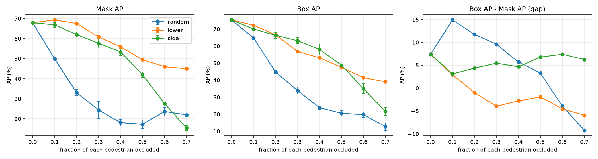
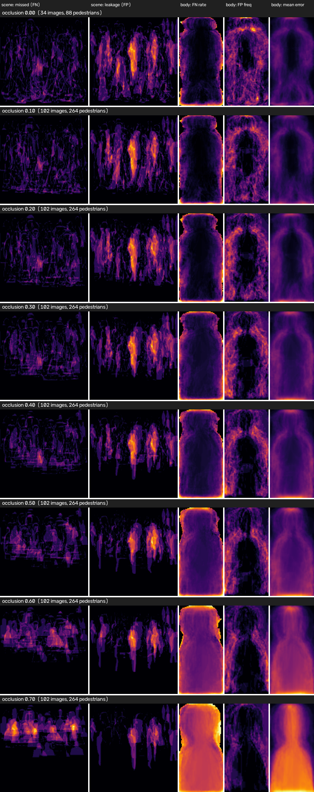

# Pedestrian Instance Segmentation with Mask R-CNN

This project implements a first Mask R-CNN baseline for pedestrian instance segmentation on the PennFudanPed dataset.

## Setup and execution

This project uses the [`uv`](https://docs.astral.sh/uv/) package manager — install it first. `uv` reads `pyproject.toml` and `uv.lock`, so every command below resolves to the same dependency set on every machine.

Pick **one** of the three Torch backends:

| Command | When to use |
|---|---|
| `uv sync --extra cpu` | CPU-only, or macOS / Windows |
| `uv sync --extra cuda` | NVIDIA GPU (CUDA 12.6) |
| `uv sync --extra rocm` | AMD GPU on Linux (ROCm 7.2) |

The extras are mutually exclusive — installing more than one is rejected by the resolver. On Linux there is no implicit CPU fallback: if you skip the extra, `torch` will not be installed and the demo will fail on import. Always pass `--extra cpu` on Linux machines without a GPU.

To prepare the model, run the DVC pipelines (data preparation + training):

```bash
uv run dvc repro
```

This produces `artifacts/maskrcnn_baseline.pt`.

To launch the live demo (browser webcam → Mask R-CNN → annotated stream back):

```bash
PYTHONPATH=src uv run python -m web --weights artifacts/maskrcnn_baseline.pt
```

Then open <http://127.0.0.1:8000> and click **Start camera**.

## Environment and dependencies

### Python and tooling

- **Python ≥ 3.14**
- **`uv`** as package manager (also used as the build backend, `uv_build`)
- **`uv.lock`** committed for reproducible installs

### Runtime dependencies

| Package | Version | Role |
|---|---|---|
| `opencv-python` | `>=5.0.0.93` | Image encoding/decoding, drawing overlays |
| `fastapi` | `>=0.162.2` | Web backend (HTTP + WebSocket) |
| `uvicorn[standard]` | `>=0.54.0` | ASGI server (`websockets`, `httptools`, `uvloop`) |
| `pycocotools` | `>=2.0.11` | COCO-style RLE masks for `--save-json` in `infer.py` |
| `scikit-learn` | `>=1.9.1` | Metrics in the training pipeline |
| `matplotlib` | `>=3.11.2` | Plots / training curves |
| `dvc` | `>=3.67.1` | Data and training pipelines (`uv run dvc repro`) |
| `certifi` | `>=2026.7.22` | TLS roots |

### Optional dependencies — Torch backend

All three extras install `torch` and `torchvision`. The `rocm` extra additionally pulls `triton-rocm>=3.8.0` on Linux.

| Extra | GPU vendor | Torch source |
|---|---|---|
| `cpu` | none | `download.pytorch.org/whl/cpu` |
| `cuda` | NVIDIA | `download.pytorch.org/whl/cu126` |
| `rocm` | AMD, Linux only | `download.pytorch.org/whl/rocm7.2` |

Torch wheels are pulled from dedicated PyTorch package indexes, not from PyPI. The three extras are declared as conflicting, so only one can be active at a time.

## Project status

The repository currently contains an end-to-end pipeline for dataset downloading and preprocessing, a custom PennFudanPed dataset loader, and a working baseline training script. The data pipeline resolves the raw PennFudanPed directory, splits it into train/validation subsets, and copies the matching image/mask pairs into `data/processed/train` and `data/processed/val`.

The main training entry point is:

- `src/train_baseline.py`

It trains a Mask R-CNN model on the processed split and saves the weights to `artifacts/maskrcnn_baseline.pt` together with validation metrics in `artifacts/metrics.json`.

## Data pipeline

The raw PennFudanPed dataset is stored under `data/raw/PennFudanPed` and has the expected structure:

- `PNGImages/`
- `PedMasks/`

The preprocessing script (`src/preprocess.py`) searches for the dataset root, creates a fixed 80/20 train/validation split with seed 42, and copies each image and corresponding mask pair into the processed folders. The dataset loader (`src/dataset.py`) returns the boxes, masks, labels, area, and crowd flags expected by Mask R-CNN.

## Baseline model configuration

- Model: Mask R-CNN with ResNet-50 FPN backbone
- Number of classes: 2 (`background` + `pedestrian`)
- Optimizer: SGD
- Learning rate: 0.005
- Momentum: 0.9
- Weight decay: 0.0005
- Batch size: 2
- Training epochs: 3 (working baseline)
- Device: CUDA when available, otherwise CPU

## Initial quantitative results

The first baseline run reports validation metrics from COCO evaluation. The initial numbers are captured in `artifacts/metrics.json` after running the script. In the first working run, the model achieves a reasonable detection signal but mask quality remains behind detection quality, which is typical for an early baseline on a small pedestrian dataset.

## Observations and limitations

- The detection boxes are generally stable and localize pedestrians well in the early stages of training.
- Mask predictions are less precise than the bounding boxes, especially around thin limbs, partial occlusions, and crowded scenes.
- The model is intentionally treated as a first baseline; further improvement would require longer training, stronger augmentation, or a pretrained backbone with more epochs.
- The pipeline is currently validated on the PennFudanPed dataset and is ready to be extended with additional experiments.

## Occlusion analysis (OpenCV inference, error heatmaps)

Scripts: `src/infer.py`, `src/occlusion_eval.py`, `src/occlusion.py`, `src/error_maps.py`, `src/cvutils.py`.

    uv run --no-sync python src/occlusion_eval.py --weights artifacts/maskrcnn_baseline.pt --output-dir artifacts/occlusion
    uv run --no-sync python src/infer.py --input data/processed/val --prob-heatmap

Synthetic grey occluders hide 10-70 % of each pedestrian (`random`, `lower`, `side`); GT = visible part (modal).
Clean baseline: Mask AP 67.9, Box AP 75.3.

| Occlusion | random | lower | side |
|---|---|---|---|
| 0.3 | 24.3 | 60.8 | 57.6 |
| 0.5 | 17.3 | 49.5 | 42.0 |
| 0.7 | 21.9 | 44.9 | 15.4 |

(Mask AP, modal GT.)




Conclusions:
- Where the occluder sits matters more than how big it is: a rectangle inside the body (`random`) already drops Mask AP to 24 at 30 %, while hiding the legs (`lower`) keeps 61.
- The model segments the visible part but does not complete the person from the edge (amodal AP is ~0 for `lower`/`side` at >= 50 %).
- Enclosed occluders get filled in, and people are split into fragments (see `docs/figures/fig06-fig10`).
- At 70 % occlusion 47-59 % of pedestrians are missed entirely.
- On the clean data, images with heavy natural occlusion score noticeably lower (Mask AP 61.8) than isolated pedestrians (74.4).
- Body heatmaps are normalised to the visible box, so they show where the mask fails, not which body part is lost first.

## Repository link

Team Git repository:
https://github.com/arsenez2006/CVProject.git
